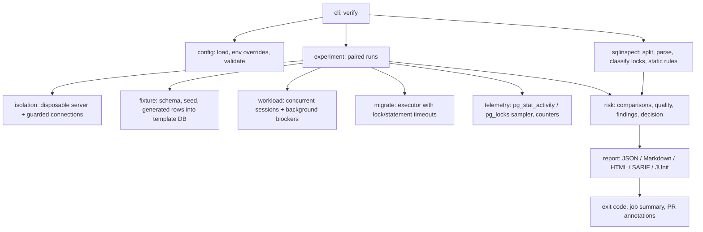

# Architecture

ProdShadow is a single Go binary, organised as a modular monolith. It needs
no service, account or network access beyond the local container engine.

## Run lifecycle

1. **Validate** – `config` decodes `prodshadow.yaml`, records the line of
   every key, warns about unknown keys with suggestions, applies an explicit
   list of `PRODSHADOW_*` overrides, and validates semantics and referenced
   files.
2. **Analyse** – `sqlsplit` splits each migration file into statements with
   exact offsets and lines (quotes, dollar quoting, nested comments,
   `BEGIN ATOMIC` bodies). `sqlinspect` parses each statement separately with
   libpg_query, so one unparsable statement does not hide the rest, derives
   table locks from the documented lock levels, plans transaction groups,
   and evaluates static rules.
3. **Provision** – `isolation` starts one hardened server per run, creates the
   unprivileged `ps_app` role and verifies the ownership token.
4. **Seed** – `fixture` loads schema, seed and generated rows into
   `ps_template` as `ps_app`, then runs `ANALYZE`.
5. **Experiment** – for each repeat, `experiment` creates the configured
   database from the template (`CREATE DATABASE ... TEMPLATE`), checkpoints,
   snapshots counters and starts the workload. In candidate phases the
   migration starts `start_after_seconds` into the measurement window in its
   own session. The window is extended until the migration finishes (plus a
   short tail) so that its whole effect is observed. The phase database is
   dropped afterwards, so no measurement reuses modified state. Phase order
   alternates (baseline first, then candidate first, ...).
6. **Evaluate** – `risk` builds per-scenario comparisons (medians across
   repeats), measures baseline noise, applies observed and quality rules,
   overrides and suppressions, and decides `pass`, `block` or
   `inconclusive`.
7. **Report** – `report` writes the versioned JSON contract and renders
   Markdown, HTML, SARIF and JUnit XML; `cli` sets the exit code, appends the
   job summary and prints annotations in GitHub Actions. `prodshadow diff`
   compares two reports, `prodshadow plan` previews a run.
8. **Destroy** – the server and its scratch directory are removed; a failure
   is reported.

## Measurement design

| Signal | Source | Strength | Weakness |
|---|---|---|---|
| Operation latency, errors, throughput | Client-side timer around every workload operation | Complete; catches short waits | Includes client and scheduling overhead |
| Who waits for which lock, blocked by whom | `pg_stat_activity` + `pg_locks` (+ `waitstart`) + `pg_blocking_pids()` every `sample_interval_ms` | Attribution (migration vs blocker vs workers) | Sampled: short waits can be missed |
| Lock waits longer than `deadlock_timeout` | Server log (`log_lock_waits`, `deadlock_timeout` 200 ms by default) parsed after each phase | Exact duration, no sampling gaps | Only waits above the threshold |
| Migration outcome | Executor: per-statement duration, SQLSTATE | Exact | — |
| WAL, deadlocks, temp files | `pg_stat_database`, `pg_current_wal_lsn()` before/after | Cheap, cumulative | Includes workload activity |

`pg_blocking_pids()` is only called for sessions that are waiting on a
lock, because it briefly locks the lock manager.

The *stall* of a scenario is the longest operation that started while the
migration ran, minus the scenario's baseline p99. Policy `max_lock_wait_ms`
is compared with the larger of the stall and the longest sampled lock wait.

## Workload engine

* **Closed loop** (default): `concurrency` sessions each pick a weighted
  scenario, run it and repeat. Throughput drops when the database blocks.
* **Open loop** (`arrival_rate`): Poisson arrivals are dispatched to a fixed
  pool; latency is measured from the *intended* start, so queueing caused by
  blocking is counted rather than hidden (no coordinated omission).
* **Background sessions** run independently of the mix and can hold a
  transaction open (`hold_ms`), reproducing reporting jobs and
  idle-in-transaction clients.
* Parameters come from named deterministic streams. Baseline and candidate
  of the same repeat draw identical parameter sequences.

## Dependencies

| Module | Why |
|---|---|
| `github.com/pganalyze/pg_query_go/v6` | The real PostgreSQL parser (libpg_query, cgo) |
| `github.com/jackc/pgx/v5` | PostgreSQL protocol, COPY, context cancellation |
| `go.yaml.in/yaml/v3` | Maintained YAML decoder |
| `github.com/santhosh-tekuri/jsonschema/v6` | Schema contract tests only |

Container engines are driven through their CLIs with argument vectors, which
keeps the dependency tree small and supports Docker and Podman alike.

## Extension points

The public interface is the CLI and the JSON report. Internally,
`isolation.Provider` and the rule registries are the seams for new
engines and rules; they are not a stable Go API yet.

## Decision records

The reasoning behind the main design choices is recorded in
[architecture decision records](adr/README.md).
